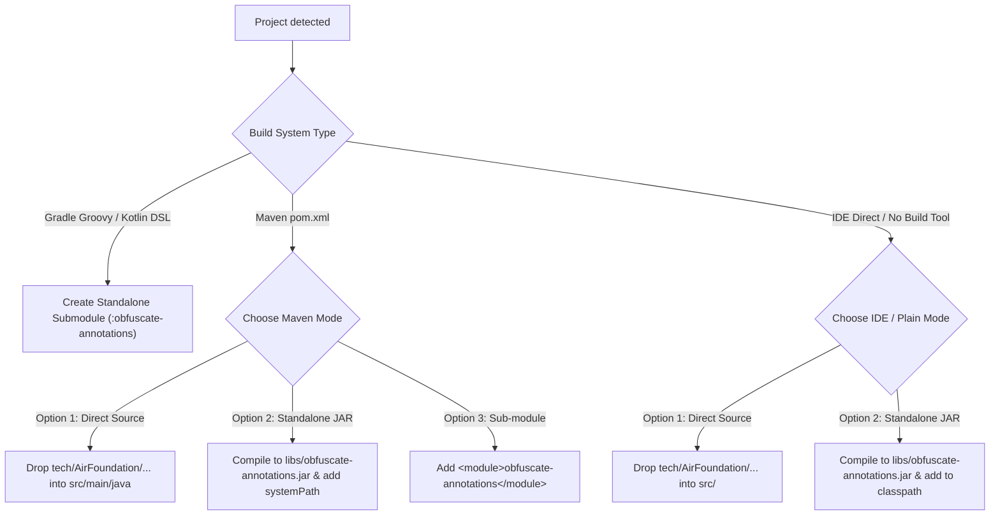

# Obfuscate-Annotation Integration (lastest branch)

## Overview

[AirFoundation/Obfuscate-Annotation](https://github.com/AirFoundation/Obfuscate-Annotation) (`lastest` branch) is a modern, zero-dependency Java annotation suite designed for fine-grained bytecode and native obfuscation control.

It provides code-level directives for Java bytecode transformers (such as Zelix KlassMaster / ZKM, Bytecode2C, and custom obfuscation engines):
- `tech.AirFoundation.obfuscate.bytecode.*` (Control Flow, String, Constant, Identifier, Indy, Exceptions, and Parameter obfuscation)
- `tech.AirFoundation.obfuscate.bytecode2c.*` (Bytecode-to-native C conversion via JNI)

All annotations specify `@Retention(RetentionPolicy.CLASS)`, meaning they are embedded in `.class` bytecode for compiler/obfuscator analysis, but are **completely stripped by JVM classloaders at runtime** for **zero memory or CPU overhead**.

---

## When to Use

Use this skill when:
- The user requests adding or integrating `AirFoundation/Obfuscate-Annotation` into any Java, Kotlin, Minecraft mod/client, or Android project.
- Fine-grained control over obfuscation is needed:
  - Disabling rename on reflection models or public APIs: `@Rename(obfuscate = false)`
  - Preserving sensitive strings or URLs: `@StringObf(obfuscate = false)`
  - Disabling flow obfuscation on time-critical loops: `@Flow(obfuscate = false)`
  - Protecting critical licensing or cryptographic routines via native compilation: `@Bytecode2c`
  - Enabling ultra-aggressive control flow flattening: `@UltraFlow`
- The user needs to integrate it as a standalone Gradle module, Maven dependency/source, or IDE classpath JAR.

Do **NOT** use when:
- The project is non-JVM (e.g. pure C++, Go, Rust, Python).
- The project strictly uses external ProGuard/R8 text rules without in-code annotation markers.

---

## Decision Flowchart



---

## Integration Pathways

### Pathway 1: Standalone Gradle Module (Recommended for Gradle projects)

For single-module or multi-module Gradle projects (Groovy DSL or Kotlin DSL):

#### Step 1: Create the Submodule Directory Structure
Create a directory named `obfuscate-annotations` (or `:annotations`):
```text
project-root/
├── obfuscate-annotations/
│   ├── build.gradle (or build.gradle.kts)
│   └── src/
│       └── main/
│           └── java/
│               └── tech/
│                   └── AirFoundation/
│                       └── obfuscate/
│                           ├── bytecode/
│                           │   ├── Exceptions.java
│                           │   ├── Flow.java
│                           │   ├── IntegerObf.java
│                           │   ├── InvokeDynamic.java
│                           │   ├── LongObf.java
│                           │   ├── ParameterChange.java
│                           │   ├── Rename.java
│                           │   ├── StringObf.java
│                           │   ├── Ultra.java
│                           │   └── UltraFlow.java
│                           └── bytecode2c/
│                               └── Bytecode2c.java
```

#### Step 2: Write Submodule `build.gradle` (or `build.gradle.kts`)
- **Groovy DSL (`obfuscate-annotations/build.gradle`)**:
```groovy
plugins {
    id 'java-library'
}

java {
    sourceCompatibility = JavaVersion.VERSION_1_8
    targetCompatibility = JavaVersion.VERSION_1_8
}

tasks.withType(JavaCompile) {
    options.encoding = 'UTF-8'
}
```

- **Kotlin DSL (`obfuscate-annotations/build.gradle.kts`)**:
```kotlin
plugins {
    `java-library`
}

java {
    sourceCompatibility = JavaVersion.VERSION_1_8
    targetCompatibility = JavaVersion.VERSION_1_8
}

tasks.withType<JavaCompile> {
    options.encoding = "UTF-8"
}
```

#### Step 3: Register in `settings.gradle` (or `settings.gradle.kts`)
- **Groovy (`settings.gradle`)**:
```groovy
include ':obfuscate-annotations'
```
- **Kotlin DSL (`settings.gradle.kts`)**:
```kotlin
include("obfuscate-annotations")
```

#### Step 4: Add Dependency in Application Module(s)
In your application or consumer subproject's `build.gradle`:
```groovy
dependencies {
    // compileOnly ensures zero runtime jar footprint
    compileOnly project(':obfuscate-annotations')
}
```
Or in `build.gradle.kts`:
```kotlin
dependencies {
    compileOnly(project(":obfuscate-annotations"))
}
```

---

### Pathway 2: Maven Integration

If the project uses Maven (`pom.xml`), determine user preference or follow standard conventions:

#### Option A: Direct Source Injection (Fastest, zero config)
Copy the package folder `tech/AirFoundation/obfuscate` directly into `src/main/java/`:
```text
src/main/java/tech/AirFoundation/obfuscate/...
```
Because the annotations have zero external dependencies, they compile seamlessly alongside existing project code.

#### Option B: Standalone JAR in `libs/`
1. Compile the annotations into `libs/obfuscate-annotations.jar` using the bundled script:
   ```powershell
   powershell -File <skill-path>/scripts/build-jar.ps1 -OutputJar ./libs/obfuscate-annotations.jar
   ```
2. Add the dependency to `pom.xml`:
   ```xml
   <dependency>
       <groupId>tech.AirFoundation</groupId>
       <artifactId>obfuscate-annotations</artifactId>
       <version>1.0.0</version>
       <scope>system</scope>
       <systemPath>${project.basedir}/libs/obfuscate-annotations.jar</systemPath>
   </dependency>
   ```

---

### Pathway 3: IDE Direct Management / Raw Java Project

For projects without a standard build tool (Eclipse `.project` / `.classpath`, IntelliJ IDEA `.iml`, or legacy Ant):

1. **Ask User or Check Preference**:
   > "当前项目由 IDE 直接管理，建议两种引入方式：
   > 1. 直接将 `tech.AirFoundation.obfuscate` 源码丢入 `src/` 目录；
   > 2. 编译为 `libs/obfuscate-annotations.jar` 并添加到项目的类路径（Classpath / Libraries）。
   > 请问您倾向哪种方式？"

2. **If Direct Source**:
   Copy `resources/src/tech` to the project's source root (e.g. `src/tech` or `src/main/java/tech`).
3. **If Compiled JAR**:
   Run `build-jar.ps1` to emit `libs/obfuscate-annotations.jar`, and instruct the user or configure `.classpath` / IDEA Library table:
   ```xml
   <!-- Eclipse .classpath example -->
   <classpathentry kind="lib" path="libs/obfuscate-annotations.jar"/>
   ```

---

## Automated Script Usage

The skill provides ready-to-run automation scripts in `scripts/`:

### 1. One-Click Project Integration: `install-annotations.ps1`
```powershell
# Auto-detects Gradle, Maven, or IDE project and applies appropriate setup:
powershell -File <skill-path>/scripts/install-annotations.ps1 -TargetProjectDir "C:\path\to\your-project"

# Explicitly create a Gradle module named 'my-annotations':
powershell -File <skill-path>/scripts/install-annotations.ps1 -TargetProjectDir "C:\path\to\your-project" -Mode gradle-module -ModuleName "my-annotations"

# Explicitly build JAR and place in libs/:
powershell -File <skill-path>/scripts/install-annotations.ps1 -TargetProjectDir "C:\path\to\your-project" -Mode ide-jar
```

### 2. Standalone JAR Builder: `build-jar.ps1`
```powershell
# Compiles all annotation sources into Java 8 compatible bytecode JAR:
powershell -File <skill-path>/scripts/build-jar.ps1 -OutputJar ".\libs\obfuscate-annotations.jar"
```

---

## Complete Annotation Reference (`lastest` branch)

| Package | Annotation | Target | Parameters | Description |
|---------|------------|--------|------------|-------------|
| `tech.AirFoundation.obfuscate.bytecode` | `@Flow` | `METHOD, TYPE` | `boolean obfuscate() default true` | Control flow obfuscation switch (loops, branching, basic block splitting) |
| `tech.AirFoundation.obfuscate.bytecode` | `@StringObf` | `METHOD, TYPE` | `boolean obfuscate() default true` | String encryption switch (DES, XOR, polymorphic) |
| `tech.AirFoundation.obfuscate.bytecode` | `@IntegerObf` | `METHOD, TYPE` | `boolean obfuscate() default true` | Integer constant encryption switch |
| `tech.AirFoundation.obfuscate.bytecode` | `@LongObf` | `METHOD, TYPE` | `boolean obfuscate() default true` | Long constant encryption switch |
| `tech.AirFoundation.obfuscate.bytecode` | `@Rename` | `METHOD, TYPE, FIELD` | `boolean obfuscate() default true` | Identifier renaming switch (class, method, field) |
| `tech.AirFoundation.obfuscate.bytecode` | `@InvokeDynamic` | `METHOD, TYPE` | `boolean obfuscate() default true` | Reference obfuscation via invokedynamic call sites |
| `tech.AirFoundation.obfuscate.bytecode` | `@ParameterChange` | `METHOD, TYPE` | `boolean obfuscate() default true` | Parameter packing into `Object[]` or context injection |
| `tech.AirFoundation.obfuscate.bytecode` | `@Exceptions` | `METHOD, TYPE` | `boolean obfuscate() default true` | Exception flow obfuscation switch |
| `tech.AirFoundation.obfuscate.bytecode` | `@UltraFlow` / `@Ultra` | `METHOD, TYPE` | `boolean obfuscate() default true` | Ultra / aggressive control flow flattening |
| `tech.AirFoundation.obfuscate.bytecode2c` | `@Bytecode2c` | `TYPE, METHOD` | `boolean obfuscate() default true` | Native C compilation via JNI (Bytecode-to-C) |

---

## Real-World Usage Examples

```java
package com.example.app;

import tech.AirFoundation.obfuscate.bytecode.*;
import tech.AirFoundation.obfuscate.bytecode2c.Bytecode2c;

// 1. Keep data transfer objects / reflection entities from being renamed
@Rename(obfuscate = false)
public class UserPayload {
    public String userId;
    public String token;
}

// 2. High-security licensing check with Bytecode-to-C and Ultra flow flattening
@Bytecode2c
@UltraFlow
public class SecurityManager {

    // Sensitive cryptographic calculation (strings encrypted by default)
    public static boolean verifyLicense(String key) {
        String server = "https://auth.example.com/check";
        return computeHmac(key, server);
    }

    // Keep log messages readable and avoid flow scrambling for diagnostics
    @StringObf(obfuscate = false)
    @Flow(obfuscate = false)
    public static void printLog(String info) {
        System.out.println("[Security] " + info);
    }
}
```

---

## Verification & Sanity Checks

After integrating into a target project, execute the following verification steps:

1. **Compilation Check**:
   - Gradle: Run `./gradlew compileJava` (or `gradlew :app:compileJava`).
   - Maven: Run `mvn compile`.
   - Direct: Run `javac` on test classes importing the annotations.
2. **Bytecode Retention Verification**:
   Inspect the compiled `.class` with `javap -v`:
   ```bash
   javap -v path/to/TargetClass.class | grep -i "RuntimeInvisibleAnnotations"
   ```
   Confirm the annotation descriptor (e.g. `Ltech/AirFoundation/obfuscate/bytecode/Rename;`) is present in `RuntimeInvisibleAnnotations` (which corresponds to `RetentionPolicy.CLASS`).

---

## Common Mistakes & Troubleshooting

| Issue | Cause | Fix |
|-------|-------|-----|
| ClassNotFoundException at runtime | Missing runtime jar when using reflection on annotations | Intended design! Annotations are `RetentionPolicy.CLASS`. Do NOT use `RetentionPolicy.RUNTIME` or reflection at runtime. Obfuscators parse the bytecode directly. |
| Gradle build warning: Java target obsolete | Using `-source 8` on modern JDK 21+ | Use `sourceCompatibility = JavaVersion.VERSION_1_8` or `options.release = 8` to avoid javac warnings. |
| Encoding errors | Files saved with Windows-1252 or BOM | Ensure all files are saved as UTF-8 without BOM, and `options.encoding = 'UTF-8'` is set in `JavaCompile`. |
| `class UltraFlow is public, should be in UltraFlow.java` | Filename mismatch | The bundled library provides both `UltraFlow.java` and `Ultra.java` alias so both `@UltraFlow` and `@Ultra` compile cleanly. |